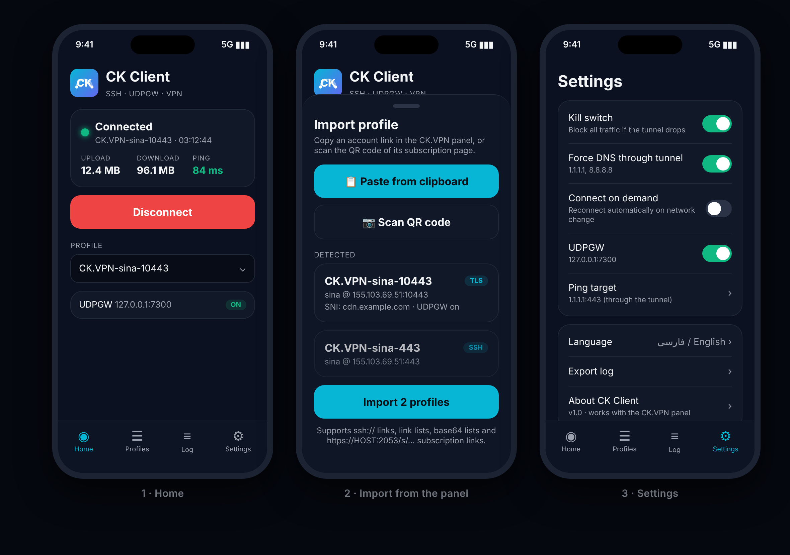

# CK Client for iOS — design

Status: the shared Go core (`../ckcore`, tested) and the Swift sources (this folder) are written — see [README.md](README.md) — but the Swift code has **never been compiled or run** (no Mac here). The Windows app in `ck-client/` is the reference; this document says what carries over, what changes and what blocks.



## 1. Scope (parity with the Windows app)

| Feature | iOS | How |
|---|---|---|
| Full VPN (all apps) | yes | Network Extension, `NEPacketTunnelProvider` |
| SSH + UDPGW (games, calls, DNS) | yes | same protocol as `ck-client/udpgw.go` |
| SSH over TLS / SNI | yes | same as Windows |
| Password / key login, host-key pinning | yes | pinned fingerprint stored with the profile |
| Import from the panel | yes | clipboard, **QR scan** (the panel already shows QR codes), `ckclient://` URL, share sheet |
| Ping on the main screen | yes | same TCP-through-tunnel measurement |
| Auto-reconnect | yes | + optional *Connect on demand* |
| Force DNS through the tunnel | yes, simpler | `NEDNSSettings` with `matchDomains = [""]` (replaces the Windows NRPT rule) |
| Kill switch | yes, optional | `includeAllNetworks = true` (iOS 14+); breaks some Apple services, so off by default |
| SOCKS5 proxy mode | **no** | iOS has no per-app/system SOCKS setting for normal apps; skip |
| Tray, installer, wintun | n/a | |

## 2. Architecture

```
┌─────────────── iPhone ───────────────┐
│  CK Client app (SwiftUI)             │        App Group + Keychain access group
│   profiles, import, status, log  ◄──────────►  profiles.json, secrets, live status
│                                      │
│  Packet Tunnel extension             │
│   utun packets ─► user-space TCP/IP ─┼─► SSH (direct-tcpip) ─► server ─► internet
│                    │                 │
│                    └─ UDP ─► UDPGW ──┼─► same SSH connection ─► badvpn-udpgw 127.0.0.1:7300
└──────────────────────────────────────┘
```

* **App** (SwiftUI): UI only. Starts/stops the tunnel with `NETunnelProviderManager`, reads status from the shared container.
* **Extension**: everything that moves packets. Runs in its own process with a hard memory limit.
* **Shared**: App Group container (profiles, status, log ring buffer) + Keychain with a shared access group (passwords / keys). Passwords never go in `profiles.json`.

### Core: two options (decide with a spike, section 6)

**A. Reuse the Go core (recommended to try first).** Move the platform-independent code of `ck-client/` (`tunnel.go`, `udpgw.go`, `import.go`, `config.go`, the netstack handlers in `vpn.go`) into a package `ckcore` with a small gomobile-friendly API (strings, ints, byte slices, callbacks) and build it with `gomobile bind -target ios` into an `xcframework`. About 80 % of the logic (SSH keep-alive/reconnect, UDPGW framing, link import, ping, host-key pinning) is then shared and already covered by tests.
Risk: Go runtime + gVisor netstack inside the extension must fit the memory limit. Historically the limit was ~15 MB and newer iOS versions allow more, but **the exact number must be measured on a real device**; tune with `debug.SetMemoryLimit`, smaller TCP buffers, fewer goroutines.

**B. Native Swift.** `swift-nio-ssh` for SSH (supports `direct-tcpip` channels), and a small C user-space TCP/IP stack (lwIP, the same one badvpn's `tun2socks` uses) for the packet side; UDPGW and link parsing re-implemented in Swift (~300 lines, protocol is simple and documented in `udpgw.go`). Smaller memory, more new code, two implementations to keep in sync.

Recommendation: spike A for one week; if the extension stays comfortably under the limit while streaming and with many connections, keep A; otherwise B.

### Extension flow
1. `startTunnel`: read profile, open SSH (TCP or TLS/SNI), verify/pin host key, check UDPGW reachable (like the Windows "udpgw reachable" log line).
2. `setTunnelNetworkSettings`: IPv4 address in a private range, `includedRoutes = [default]`, IPv6 default route into the tunnel (no leak), DNS = profile DNS with `matchDomains [""]`, MTU 1200 (keeps UDP under badvpn's `--udp-mtu`).
3. Read packets from `packetFlow`, feed the user-space stack; every TCP flow → SSH `direct-tcpip`, every UDP flow → UDPGW session (never block the packet loop: the Windows version stalled until handlers were moved to goroutines — same rule here).
4. Supervisor: SSH keep-alive every 15 s, reconnect with backoff, `reasserting = true` while reconnecting, ping every 3 s written to the shared status.

## 3. Screens (see mockup)
Colours/logo are the panel's: bg `#0b1120`, card `#111827`, border `#1f2937`, primary `#06b6d4`, ok `#10b981`, error `#ef4444`, warn `#f59e0b`, logo gradient `#06b6d4 → #6366f1`.

1. **Home** — status card (dot, profile, time, upload / download / ping), big Connect/Disconnect button, profile picker, UDPGW state.
2. **Import** — *Paste from clipboard* (use `PasteButton`, iOS 16+, so no paste-permission prompt), *Scan QR*, list of detected profiles with TLS/SSH badge, *Import N profiles*. Accepts exactly what the Windows app accepts: `ssh://` links, base64-login links, `?security=tls&sni=` links, lists, base64 lists, `https://HOST:2053/s/<token>` subscription links.
3. **Settings** — kill switch, force DNS, connect on demand, UDPGW + address, ping target, language (English / فارسی, RTL), export log, about.
Also: Profiles list/editor, Log. Persian is a first-class language (SwiftUI mirrors layout automatically).

## 4. Data model
Same JSON as the Windows `Profile` (`name, host, port, user, transport direct|tls, sni, udpgwEnabled, udpgwAddr, dns, pingTarget, hostKey`) minus `mode`/`socksPort`; `password` and `privateKey` live in the Keychain, keyed by profile name.

## 5. Requirements and blockers (read before investing)
* **A Mac with Xcode is required** to build and sign. It cannot be built on Linux/Windows.
* **Paid Apple Developer Program** is required: the Network Extension (Packet Tunnel) entitlement is not available to free accounts, so free sideloading (AltStore with a free ID) cannot run a VPN. Cost is about USD 99 per year.
* **App Store:** Apple's guideline 5.4 allows VPN apps only from developers enrolled as an **organization**, and the app must use the NE APIs. As an individual you can still use **TestFlight** (up to 10,000 testers; the first build of each version goes through beta review) or **Ad Hoc** (100 devices per year, installed by UDID).
* **Availability depends on where you live and where users are:** Apple Developer enrolment and App Store distribution are restricted in some countries (sanctions). Check this first; I have not verified it for your case.
* **Content/legal:** an App Store review of a "tunnel/bypass" style VPN is unpredictable; describe it as a client for your own server.
* Not testable from this environment: all of the above, plus real-device memory, background behaviour and battery.

## 6. Plan (rough estimates for one developer who knows Swift)
0. **Spike (3–5 days):** minimal extension that tunnels one TCP flow + one UDP flow through SSH/UDPGW; measure memory on a device. Decision A vs B.
1. **MVP (3–4 weeks):** profiles + Keychain, import (clipboard + QR), connect/disconnect, TCP + UDPGW, DNS, status + ping, log.
2. **Hardening (2 weeks):** reconnect/Wi-Fi↔cellular handoff, on-demand, kill switch, IPv6, host-key change UX, localisation (EN/FA), accessibility.
3. **Distribution (1–2 weeks):** TestFlight, privacy manifest, App Store text if eligible.

## 7. Repo layout (proposal)
```
ck-client/                 Windows app (existing)
ck-client/core/            ckcore: shared Go core (to extract from main package)
ck-client/ios/             this design, later the Xcode project
  CKClient/                SwiftUI app
  PacketTunnel/            NE extension
  Shared/                  App Group models, Keychain helper
```
Extraction of `ckcore` from the Windows `main` package is a prerequisite for option A and also makes the Windows code easier to test.

## 8. Decisions needed from the owner
1. Do you have (or can you get) a **Mac** and an **Apple Developer** account — individual or organization?
2. Distribution: TestFlight/Ad Hoc for a small group, or App Store (needs an organization)?
3. Is iOS the priority over Android? (Android needs no paid account for sideloading and `VpnService` is simpler; the same Go core could serve both.)
